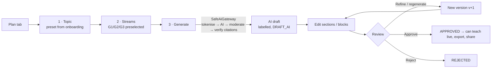
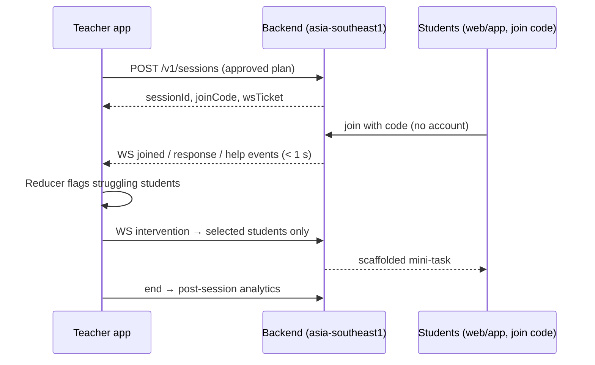

# 1 · Product requirements summary and user flows

## Problem
Singapore teachers spend significant time adapting the same lesson for different learning needs (Full SBB G1/G2/G3 in secondary, Foundation/Standard in upper primary, H1/H2/H3 in pre-U), producing differentiated worksheets, and finding out *during* a lesson who is stuck. Existing tools are generic, not syllabus-aware, and rarely designed around student-data protection for minors.

## Goal
An AI teaching assistant that (1) generates syllabus-aligned, stream-differentiated lesson plans and worksheets in under 3 steps, (2) runs live checks for understanding with real-time struggle detection and targeted intervention, and (3) treats student data as sensitive by design: pseudonymised, never sent identifiable to AI, encrypted, auditable and deletable.

## Users

| Persona | Primary jobs | Key needs |
|---|---|---|
| Classroom teacher (P/S/JC) | Plan, differentiate, teach, mark | Speed, editability, trust in AI output, offline |
| Relief teacher | Teach someone else's class at short notice | Ready-to-run plan, roster without real names |
| Subject head / HOD | Share and standardise plans, review quality | Department sharing, versioning, analytics by stream |
| Year head / CCA teacher | Coordinate groups and announcements | Grouping, scheduled posts, no private DMs |
| School admin / DPO | Configure policy, respond to data requests | Admin panel, retention, export/delete, audit log |
| Student | Join and respond | Join by code, no account, no leaderboard shaming |

## Scope by module (MVP = ✅ built in scaffold, ◐ partial, ○ designed only)

| Module | Feature | Status |
|---|---|---|
| Planner | Level → subject → topic tree (placeholder codes), stream selection, 3-step generate | ✅ |
| | Objectives, prior knowledge, success criteria, timed flow, differentiation per tier, AfL checks, 21CC links | ✅ |
| | Edit every section, duplicate, version (refine = new linked version), tags, share with department | ✅ (sharing flag local; server sync v1) |
| | Interactive block timeline (explain, poll, short answer, drawing, sorting, MCQ, reflection, group task, exit ticket) | ✅ add/edit/reorder; drag gesture ○ |
| | Regenerate, refine (easier/extension/SG context/shorter/more interactive), tone | ✅ |
| Library | ResourceRepository + MOE (mock), user uploads, open-licensed adapters | ✅ |
| | Search & filter by level/subject/topic/type/stream/source; source & licence on each item | ✅ |
| | Bookmarks, offline flag, AI references selected resources with verified attribution | ✅ |
| Worksheets | Inputs: topic, objectives, stream(s), count, types, difficulty mix | ✅ |
| | Coordinated versions per tier; scaffolds (worked example, hints, word bank, sentence starters, graphic organiser) / challenge items | ✅ |
| | Answer key, marking points, misconceptions | ✅ |
| | SG-English spelling + reading level + coordination checks | ✅ |
| | Export: PDF | ✅ · Google Docs/Slides, DOCX via backend ○ |
| Classes | Roster CSV import with pseudonymisation and identifier-column rejection | ✅ |
| | Assignments with due dates, rubric, submission counts, WorkManager reminders | ✅ |
| | Announcements (students/parents), templates, scheduled posts, read counts; no DMs unless enabled | ✅ (delivery via backend v1) |
| | Today dashboard: lessons, to mark, drafts to review, pending interventions | ✅ |
| Live | Join code, per-student status, confidence, response feed, word cloud | ✅ simulated transport |
| | Struggle flags (help, stuck, low confidence, repeated incorrect, inactive, pastoral) | ✅ |
| | Auto-grouping (stream / mixed-ability / random) with group task | ✅ |
| | Targeted interventions pushed to selected students only | ✅ |
| | AI feedback on open responses with approve/edit/reject | ◐ domain + API; UI v1 |
| | Gamified review (team leaderboards, streaks, power-ups), post-session analytics UI | ○ v1/v2 (analytics engine ✅) |
| Privacy | Onboarding privacy walkthrough + consent, privacy notice, DPO contact | ✅ |
| | PII tokenisation before AI, audit log, moderation | ✅ |
| | SQLCipher DB, Keystore secrets, biometric/PIN lock, FLAG_SECURE, no backups | ✅ |
| | RBAC roles, school admin panel, retention purge, export/delete | ✅ (server-side enforcement v1) |

## Success metrics
- Time to first usable plan ≤ 60 s; ≤ 3 taps from Plan tab to generated plan.
- ≥ 70 % of AI drafts approved after edits (quality proxy); < 1 % blocked by moderation.
- Live session: p95 event-to-screen < 1 s with 45 students.
- 0 identifiable student records in AI request logs (audited monthly).

## Key user flows

### A. Generate and approve a lesson plan (≤ 3 steps)

### B. Differentiated worksheet
Topic → streams → count/types/difficulty → **Generate** → tabs per version (G1 | G2 | G3) → quality checks (spelling, reading level, coordination, scaffolds) → toggle answer key → **Approve** → PDF export / share.

### C. Live lesson with intervention

### D. Onboarding
Welcome → levels & subjects → privacy walkthrough (pseudonyms, AI tokenisation, encryption/SG hosting, rights) → privacy notice + consent (notice acknowledgement required; AI and analytics optional) → Today.

### E. Data request (access/correction/deletion)
Today → shield icon → Privacy & data → Export my data (JSON) or Delete all → audit logged. Student/parent requests go to the school DPO (contact shown in-app), who uses the admin console (v2) or `DELETE /v1/students/{id}`.
