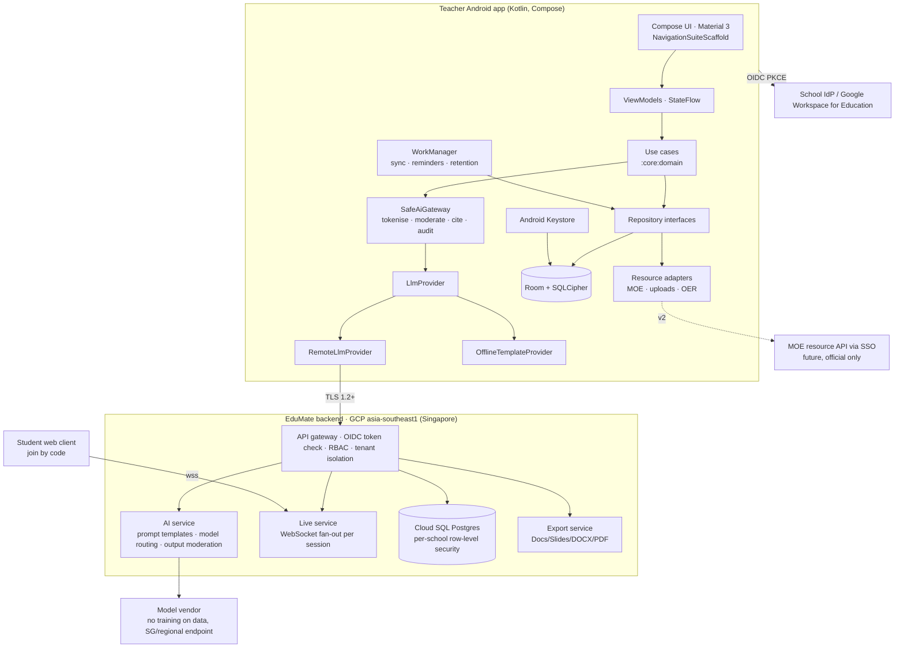

# 2 · Architecture and module breakdown

## System context


## Layering (Clean Architecture)
| Layer | Module / package | Depends on | Notes |
|---|---|---|---|
| Domain | `:core:domain` (pure Kotlin/JVM) | coroutines, serialization, javax.inject | Models, repository interfaces, use cases, `SafeAiGateway`, `PiiTokeniser`, moderation, quality checks, live reducer, grouping, analytics. **31 JVM unit tests.** |
| Data | `app/.../data` | domain, Room, Retrofit, OkHttp, DataStore | Repository impls, adapters, Keystore/SQLCipher, remote API, live transports |
| Presentation | `app/.../ui` | domain, data (via Hilt) | Compose screens + `@HiltViewModel`s, unidirectional state |
| Platform | `app/.../work`, `security`, `di` | all | WorkManager workers, app lock, Hilt modules |

**Planned split as the codebase grows** (keeps build times low): `:core:data`, `:core:ui` (design system), `:feature:plan`, `:feature:library`, `:feature:live`, `:feature:classes`, `:feature:privacy`. The domain module is already isolated so that split is mechanical.

## Key decisions

| Decision | Choice | Why | Revisit if |
|---|---|---|---|
| AI access | App → EduMate backend → vendor. `LlmProvider` interface; no keys in APK | Keys, prompts and model choice stay server-side; one place to enforce moderation and region | — |
| PII before AI | On-device tokenisation (`PiiTokeniser`) **and** server-side re-check | Defence in depth; the device knows roster names, the server doesn't need to | — |
| Citations | Gateway rebuilds citations from teacher-supplied resources only; others dropped and audited | Enforces "never fabricate citations" in code, not prompts | — |
| Offline | Room is the source of truth; `FallbackLlmProvider` uses on-device templates when offline; WorkManager sync | Planning works on MRT / poor school Wi-Fi | — |
| Real-time | Own WebSocket service (`WebSocketLiveSessionGateway`), simulated in dev | Data residency and per-school isolation are simpler to control than Firestore rules; predictable latency for 45 clients; students don't need Firebase accounts | Firestore in `asia-southeast1` is acceptable to schools; it is a drop-in `LiveSessionGateway` |
| Auth | OIDC (AppAuth, PKCE) against Google Workspace for Education or the school IdP, exchanged for a short-lived backend token | Works for Google and non-Google schools; Firebase Auth optional behind the same interface | — |
| Local encryption | SQLCipher with 256-bit random passphrase wrapped by Keystore AES-GCM | Protects roster/response data at rest even on rooted devices | — |
| Hosting | GCP `asia-southeast1` for all stores and compute | Data residency expectations of SG schools | Government schools may require GCC-approved hosting (see open question 1) |

## Performance budget
- **Cold start < 2 s:** `Application.onCreate` does no DB/network work; Hilt singletons are lazy; SQLCipher opens on first query; baseline profiles to be added before release.
- **Live updates < 1 s:** single-coroutine reducer (no locks), UI sampled at 250 ms, WebSocket ping 20 s; server fan-out sized for 45 students per session.
- **45 concurrent students:** enforced in `LiveSessionReducer` (`MAX_STUDENTS`) and `CreateSessionRequest.maxParticipants`.

## Observability without personal data
`CrashReporter` and `Analytics` are interfaces (wire Crashlytics/Firebase Analytics or an SG-hosted alternative). Rules: no free text, no student IDs, no class names; events carry enums and counts only; analytics gated on consent. Feature flags: remote config with local defaults (`BuildConfig.USE_MOCK_BACKEND` today).

## Package map (app)
```
sg.edumate.app
├─ data/            curriculum · export (PDF) · live (simulated + WebSocket) · local (Room) · remote (Retrofit, providers)
│                   repository · resource (adapters) · settings (DataStore) · PrivacyDataService
├─ di/              Core, Database, Network, AI, Bindings modules
├─ security/        KeystoreCipher · SecretStore · AppLockManager
├─ work/            SyncWorker · RetentionWorker · ReminderWorker · WorkScheduler
└─ ui/              navigation · theme · components · today · plan · library · live · classes · privacy · onboarding
```
